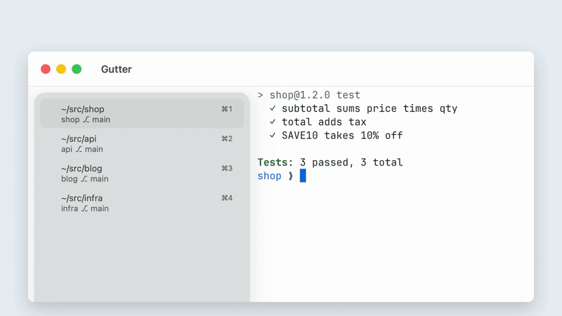

# Gutter

A native macOS terminal for running several coding agents side by side.
It is [Ghostty](https://ghostty.org)'s engine and renderer, with a sidebar of
full-height sessions in place of a tab bar.



[Watch it as an MP4](media/gutter-demo.mp4).

## Features

**Sessions**

- **A sidebar instead of a tab bar.** Each session gets a row with its folder
  and git branch, so ten sessions are as easy to tell apart as two. Switch with
  ⌘1–9 or ⌃Tab, drag rows to reorder, and hide the sidebar with ⌘B.
- **One window per project.** ⌘N opens a window with its own sessions.
  **File > Rename Window...** names it, and the name shows in the title bar,
  the Window menu and the Dock's window list.

**Knowing when to look**

- **A dot when a session needs you.** Claude Code handing the turn back, a
  bell, or a build finishing in a session you aren't looking at lights a dot
  on its row. `DESIGN.md` lists exactly what does and doesn't.
- **A count on the Dock icon**, so you see it without switching to Gutter.
  **View > Next Session Needing Attention** jumps to the next one.

**Working with agents**

- **New request** (⌘⇧T): pick a folder and a tool such as `claude`, type a
  prompt, and it runs in a new background session while you keep working.
- **See what changed** (⌃⇧G): a side-by-side diff of the repo. Show what isn't
  committed yet, or everything a pull request from this branch would show.

**Terminal**

- **Ghostty underneath.** Metal rendering, ghostty's config syntax, its bundled
  themes, and find in scrollback.
- **Split panes inside a session.** ⌘D splits right, ⌘⇧D splits down.
- **Live theme picker.** **Gutter > Choose Theme...** previews each theme as
  you move through the list.

## Why Gutter

Ghostty is fast but has no vertical tabs. iTerm2 has vertical tabs but isn't
Ghostty. Gutter is the overlap.

Ghostty won't add them: it declined vertical tabs in
[discussion #2549](https://github.com/ghostty-org/ghostty/discussions/2549),
closed on 2026-03-13, because custom tab bars conflict with its preference for
native platform UI.

Gutter is not a fork and not a full-featured terminal. It is a window, a
sidebar of sessions, and one pane tree per window, plus a few tools for
running agents. For everything else, use Ghostty or iTerm2. `DESIGN.md`
records why Gutter is shaped this way and what was deliberately left out.

## Install

Gutter is built from source. You need:

- An Apple Silicon Mac with macOS 13 or later (built and tested on 26.x).
- Xcode at `/Applications/Xcode.app` with the **Metal Toolchain** component
  (**Xcode > Settings > Components**).

The repo carries a prebuilt libghostty in `deps/`, so you don't need a ghostty
checkout or Zig.

```sh
./build.sh              # compile, about 30 s
./make-app.sh           # assemble dist/Gutter.app
open dist/Gutter.app
```

`./make-app.sh --install` also copies the app to `/Applications`. To pick up a
new build, quit the running copy and open it again.

Always run the `.app`. The bare `bin/Gutter` binary crashes on launch.

To keep macOS privacy grants such as Full Disk Access across rebuilds, set up a
signing certificate once. See [Signing certificate](#signing-certificate).

## Configuration

### Config file

Gutter reads `~/.config/gutter/config`, in ghostty's config syntax: theme, font
size, working directory and keybinds. ⌘, opens it and ⌘⇧, reloads it.

- **First launch** writes a short commented template with one setting,
  `notify-on-command-finish = unfocused`. That line lights the dot when a
  command finishes in a session you aren't looking at. Edit or delete it.
- **Gutter never rewrites your config**, except for the one `theme =` line that
  **Gutter > Choose Theme...** saves. The picker changes nothing until you
  click Save.
- **Ghostty's own config is not loaded.** To inherit it, add
  `config-file = ?~/.config/ghostty/config`. The `?` means "skip if missing".

`CONFIG.md` lists the settings worth knowing about. Ghostty's own reference has
several hundred.

### Launchers

Launchers are the tools New Request (⌘⇧T) can start. They live in their own
file, `~/.config/gutter/launchers`, because libghostty rejects keys it doesn't
know:

```
launcher = claude
launcher = pclaude
launcher-for ~/projects = pclaude
folder = ~/src/screenings_app
```

- **`launcher`**: one command per line. The first is the default.
- **`launcher-for`**: gives a folder tree its own default. The longest matching
  path wins.
- **`folder`**: adds a folder to the sheet's list, next to the folders your
  sessions are already in.

Commands are typed into the session's shell, so aliases work.

## Keyboard shortcuts

⌘⇧/ (**Help > Keyboard Shortcuts**) shows the same list in the app.

### Windows and sessions

| Keys | Action |
|---|---|
| ⌘N | New window, starting in the current session's folder. Also on the Dock icon's right-click menu |
| ⌘⇧W | Close the window and its sessions, after asking |
| ⌥⌘⇧W | Close all windows, after asking |
| ⌘Q | Quit, after asking |
| ⌘T | New session, in the current session's folder |
| ⌘W | Close the pane. Closing a session's last pane closes the session |
| ⌥⌘W | Close the whole session, however many panes it has |
| ⌘⇧T | New request: pick a folder and a tool, type a prompt (⇧Return for a new line), and run it in a new background session |
| ⌘⇧R | Rename the session |
| ⌘1–9 | Go to session N |
| ⌃Tab / ⌃⇧Tab | Next / previous session |
| ⌘B | Show or hide the sidebar |
| ⌃⇧G | Show changes (side-by-side diff) |
| ⌘, / ⌘⇧, | Open / reload the config |
| ⌘⇧/ | Keyboard shortcuts |

⌘B and ⌃⇧G also have toolbar buttons. The toolbar is hidden in fullscreen, so
use the keys or the **View** menu there.

### Panes

| Keys | Action |
|---|---|
| ⌘D / ⌘⇧D | Split right / down |
| ⌘] / ⌘[ | Next / previous pane |
| ⌥⌘ + arrow | Focus the pane in that direction |
| ⌃⌘ + arrow | Resize the pane |
| ⌘⇧Return | Zoom the pane, and back |
| ⌃⌘= | Make all panes the same size |

### Text

| Keys | Action |
|---|---|
| ⌘C / ⌘V / ⌘A | Copy / paste / select all |
| ⌘F | Find in scrollback |
| ⌘G / ⌘⇧G | Next / previous match |
| ⌘E | Find the selected text |

### Mouse

- **Sidebar:** drag a row to reorder sessions (⌘1–9 follow the new order).
  Double-click a row to rename it. Hover a row, or swipe it left, for a close
  button.
- **Links:** ⌘-hover underlines a URL and ⌘-click opens it. Inside a program
  that captures the mouse, such as Claude Code or vim, hold ⌘⇧ instead. This
  matches Ghostty.

## Changes window

⌃⇧G opens a side-by-side, whole-file diff of the current session's repo. A
toggle in its header picks what you compare against:

- **Uncommitted**: `HEAD` against your working tree. What isn't committed yet.
- **Branch**: what a pull request would show. The merge base with the target
  branch against your working tree, so every commit on this branch plus
  anything still uncommitted.

In Branch mode, a menu next to the toggle picks the target branch: the default
first, then the rest, most recently committed first. Gutter remembers your
choice for each repo. The default comes from `origin/HEAD`, falling back to
`origin/main`, `origin/master`, `main` and `master`; a remembered branch that
was deleted falls back to it too. `DESIGN.md` explains why Branch mode uses the
merge base rather than the branch tip. The file list matches
GitHub's "Files changed", plus your uncommitted work, which the header counts
separately.

The window never reloads by itself, so you never lose your place. When the repo
changes underneath it, the Refresh button gets a dot.

| Keys | Action |
|---|---|
| ⌘] / ⌘[ | Next / previous change |
| ⌘R | Refresh |
| ⌘F | Find in the file on screen |
| ⌘G or Return / ⌘⇧G or ⇧Return | Next / previous match |
| ⌘E | Find the selected text |
| Esc | Close the find bar |
| ⌘W | Close the window |

Find searches one side: the one you last clicked, or the one picked in the find
bar, marked with an accent border. Matches are highlighted and marked on the
change map, and the search stays while you move between files.

## Troubleshooting

- **Config errors at launch.** Watch the log for `config error:` lines:
  `/usr/bin/log stream --style compact --predicate 'process == "Gutter"'`.
  "Theme not found" usually means the bundled themes are missing. Run
  `./make-app.sh` again.
- **Gutter quits when the last session closes.** This is intentional, and
  matches Terminal.app.
- **No session titles.** Titles come from the shell. A new shell shows a
  placeholder until its first prompt draws.

## Development

`DESIGN.md` holds the design decisions, including what was declined. Read it
before proposing a feature.

### Architecture

Every pane is a real libghostty surface: Metal rendering, PTY handling, VT
emulation, input and IME, and config loading all come from ghostty's core and
its own Swift wrapper. Gutter is the window shell, sidebar and session manager
in AppKit, over a pane tree in ghostty's own SwiftUI. There is no Xcode
project: everything builds with `swiftc` and scripts.

Runtime ownership, top to bottom:

```
main.swift            process setup: GHOSTTY_RESOURCES_DIR, ghostty_init, keybind overrides
└─ AppDelegate        app lifecycle + menu actions + the list of windows
   ├─ Ghostty.App     libghostty runtime + config (from Vendor/), one for the app
   ├─ GhosttyBridge   the only place that knows ghostty's notification names
   └─ MainWindowController          window, toolbar, fullscreen chrome  (one per ⌘N)
      ├─ SessionManager             this window's session list and which one is selected
      └─ MainSplitViewController
         ├─ SidebarViewController            one table row per session
         └─ TerminalContainerViewController  hosts the selected session's panes
            └─ SessionTreeView (SwiftUI)     ghostty's SplitView + InspectableSurface
```

- **`SessionManager`** is the model. It owns the sessions and holds no AppKit
  policy. There is one per window, and `AppDelegate.front` (the window that was
  last key) is the one the menu bar acts on.
- **`MainWindowController`** owns every session-to-UI reaction: reloading the
  sidebar, showing the selected surface, giving it first responder.
- **`GhosttyBridge`** turns libghostty notifications into session calls. Audit
  it for API drift when ghostty is updated. libghostty's notifications are
  app-wide, so it also routes each one to the window that owns the surface.
- **A `Session` is a tree of `Pane`s.** Each pane is a live
  `Ghostty.SurfaceView` with its own title, activity dot and progress spinner.
  The sidebar row shows the focused pane's title, but ORs attention across all
  panes, so an agent finishing in a pane you aren't looking at still lights the
  dot.
- **The terminal area is ghostty's own SwiftUI.** `SessionTreeView` is a
  near-copy of upstream's `TerminalSplitTreeView`. Everything inside a pane
  (find bar, dimming, resize overlay, pointer cursor, sizing) comes from the
  vendored views. See `DESIGN.md`, "The terminal area is ghostty's, not ours".

### Layout

| Path | Purpose |
|---|---|
| `Sources/` | App code: `AppDelegate` (lifecycle + menu actions), `MainWindowController` (window, toolbar, fullscreen; also the `BaseTerminalController` the core needs for split keybinds), `GhosttyBridge` (libghostty boundary), `SessionManager` (sessions, panes, status folds), `SidebarViewController`, `MainSplitViewController` (sidebar + pane container), `SessionTreeView` (the pane tree, in ghostty's SwiftUI) |
| `Sources/Shims.swift` | Stub types the vendored wrapper `as?`-casts to (no-op in this app) |
| `Sources/Compat.swift` | Shims for Swift-overlay APIs missing from the CommandLineTools toolchain |
| `Vendor/` | Swift wrapper copied from the ghostty checkout by `vendor.sh` (SurfaceView with input/IME, config, app runtime) |
| `deps/` | Self-contained build inputs: stripped static `libghostty.a`, C headers/modulemap, resources (themes, terminfo), and `GHOSTTY_VERSION`, the release they came from. Committed, so no ghostty checkout is needed to build |
| `update-ghostty.sh` | Rebuilds `deps/` and `Vendor/` from the release in `deps/GHOSTTY_VERSION` |
| `vendor.sh` | Re-copies and patches the wrapper (the patches live here, reproducibly) |
| `build.sh` / `make-app.sh` | Build the binary / assemble `dist/Gutter.app` (bundles themes, shell integration and terminfo) |
| `Info.plist` | Bundle metadata (bundle id, minimum macOS 13) |
| `DESIGN.md` | Why Gutter is shaped this way; declined and deferred features |
| `CONFIG.md` | The settings worth setting, and the keys Gutter claims from the core |
| `media/` | The demo video at the top of this file |

### Working on the code

- **App code:** edit `Sources/`, then `./build.sh && ./make-app.sh`. There is
  no Xcode project.
- **Fast syntax check:** run the `swiftc -typecheck` command inside `build.sh`
  by hand, or just run `./build.sh`, which is fast once the archives are
  repaired.
- **Linking a ghostty checkout:** `build.sh` prefers the committed `deps/`.
  Setting `GHOSTTY=<checkout>` links that checkout's GhosttyKit.xcframework
  instead.
- **Runtime logs:** ghostty logs through `os.Logger`. Config errors, renderer
  health and spawn failures all show up in
  `/usr/bin/log stream --style compact --predicate 'process == "Gutter"'`.
- **Why the bare binary crashes:** ghostty's logger force-unwraps
  `Bundle.main.bundleIdentifier`, which only exists inside the `.app`.
- **Adding a keybind** means editing three places by hand: `MainMenu.swift`
  (the menu item), `ShortcutsWindowController.swift` (the ⌘⇧/ panel) and the
  tables in [Keyboard shortcuts](#keyboard-shortcuts). Core keybind overrides
  also go in the table of claimed keys in `CONFIG.md`.
- **Pane keys** are ghostty's own defaults, claimed by the core rather than
  bound here. Most also have a menu item, so they work when no pane has focus.
  The two arrow sets (focus and resize) are core-only: eight more menu items
  would swamp the View menu.
- **Keybind overrides** (`cmd+t=new_tab`, `cmd+9=goto_tab:9`) are injected from
  `main.swift` through a temp config file and
  `Ghostty.Config.embedderConfigFile`. The core has no default `cmd+t` on macOS
  (upstream handles it in its app menu), and `goto_tab` only defaults to 1–8.
- **Don't override `command`** in the config overrides: repeated `command` keys
  append to the default argv instead of replacing it.
- **⌘] and ⌘[** mean "next pane" in the main window and "next change" in the
  changes window. They don't collide: in the changes window they are that
  window's own button key equivalents, not menu items or core keybinds.

### Signing certificate

Without one, `make-app.sh` signs ad hoc, and macOS silently refuses privacy
grants (Full Disk Access, Downloads, Documents and so on) after every rebuild.
They still show as on in System Settings. A self-signed certificate keeps the
signature the same across builds. Set it up once per Mac:

1. Open Keychain Access. On recent macOS it isn't in `/Applications`:
   `open "/System/Library/CoreServices/Applications/Keychain Access.app"`.
2. Choose **Keychain Access > Certificate Assistant > Create a Certificate...**
3. Name it `Gutter Dev` exactly (`make-app.sh` finds it by name). Set Identity
   Type to **Self Signed Root** and Certificate Type to **Code Signing**. Click
   Create, then Done.
4. Check that `security find-identity -p codesigning` lists `"Gutter Dev"`.
   `CSSMERR_TP_NOT_TRUSTED` next to it is expected and harmless.
5. Run `./make-app.sh`. It now prints `signed with "Gutter Dev"`. If macOS asks
   whether `codesign` may use the key, choose **Always Allow**.
   `codesign -dvv dist/Gutter.app 2>&1 | grep Authority` should show
   `Authority=Gutter Dev`.
6. Grant Full Disk Access one last time: in **System Settings > Privacy &
   Security > Full Disk Access**, remove Gutter, add `dist/Gutter.app`, then
   quit with ⌘Q and reopen it. Later rebuilds keep the grant.

To use a different name, set `LOCAL_SIGN_NAME=...`. A Developer ID identity in
`SIGN_ID` takes priority over both, for builds other people run.

### Updating ghostty

This is rare: only for a newer ghostty core. Gutter currently links ghostty
v1.4.0. To move to another release:

1. Put the new tag and the commit it points at in `deps/GHOSTTY_VERSION`.
2. Run `./update-ghostty.sh`. It clones that tag and downloads the Zig version
   the tag asks for (checksum-verified) into `~/.cache/gutter-ghostty`
   (override with `GUTTER_GHOSTTY_CACHE`), builds libghostty, refreshes
   `deps/`, and runs `./vendor.sh` to refresh the Swift wrapper.
3. If `vendor.sh` stops on an `assert`, upstream moved the code one of its
   patches expects: re-aim the patch, or delete it if upstream now does the
   same thing. If the compile then can't find a type, the wrapper started
   using another app-target file - add a `cp` for it to `vendor.sh`.
4. Run `./build.sh`, audit `GhosttyBridge.swift` against the `ghostty.h`
   diff, check the app, and commit `deps/`, `Vendor/` and the scripts.

Full Xcode isn't needed. Without it, the script reuses the compiled shaders
from the library it replaces (refusing if `shaders.metal` changed) and shims
the final `xcodebuild -create-xcframework` step. `DESIGN.md`, "Updated by a
script, not a submodule", has the reasons.

### Sharing the binary

`dist/Gutter.app` is self-contained (static libghostty, themes, shell
integration), so you can zip it:

```sh
cd dist && zip -r Gutter.zip Gutter.app
```

Tell recipients:

- **It runs on Apple Silicon only**, macOS 13 or later.
- **Gatekeeper blocks the first launch** unless it was signed with a Developer
  ID (`SIGN_ID`). Right-click the app and choose Open, or run
  `xattr -cr Gutter.app`.
- **It reads `~/.config/gutter/config`**, not their Ghostty config.

The embedded libghostty is MIT-licensed, © Mitchell Hashimoto and the ghostty
contributors. Keep that attribution if you redistribute.
